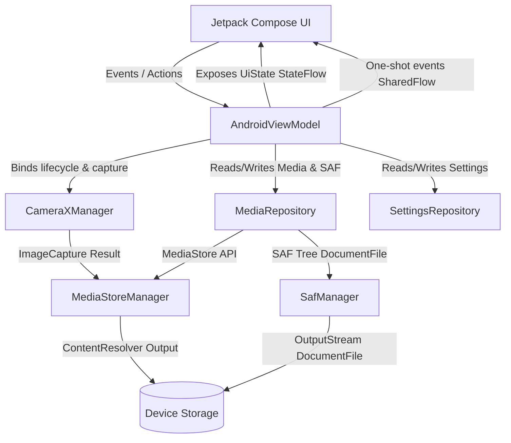

# CamCraft Architecture & Data Flow

CamCraft strictly implements the **MVVM (Model-View-ViewModel)** architectural pattern with unidirectional data flow and clean separation of concerns.

---

## 🏛️ Package Architecture

```
com.camcraft.app/
├── data/
│   ├── camera/           # CameraX Manager, CameraState, CameraViewModel
│   ├── editing/          # ImageEditor, CropOverlayMath, ExifUtils
│   ├── media/            # MediaRepository, MediaStoreManager, SafManager, MediaItem
│   └── settings/         # SettingsRepository, UserPreferences, DataStoreManager
├── ui/
│   ├── camera/           # CameraScreen, PreviewViewContainer, CameraControls, GridOverlay, TimerOverlay
│   ├── editor/           # EditorScreen, CropOverlay, EditorViewModel
│   ├── gallery/          # GalleryScreen, DetailScreen, MetadataBottomSheet, GalleryViewModel
│   ├── landing/          # LandingScreen, LandingViewModel
│   ├── navigation/       # NavGraph, Screen routes
│   ├── settings/         # SettingsScreen, SettingsViewModel
│   └── theme/            # Color, Type, Theme
└── MainActivity.kt
```

---

## 🔄 Data Flow Architecture (Mermaid)



---

## 🎥 Camera Lifecycle Management
1. `PreviewViewContainer` embeds CameraX `PreviewView` inside Compose `AndroidView`.
2. `LaunchedEffect` keyed on `lensFacing`, `flashMode`, and `targetRotation` triggers `CameraViewModel.bindCamera`.
3. `ProcessCameraProvider.unbindAll()` is executed before every new binding to guarantee no background camera leaks.
4. Camera use-cases (`Preview` + `ImageCapture`) are bound to the `LocalLifecycleOwner`.
